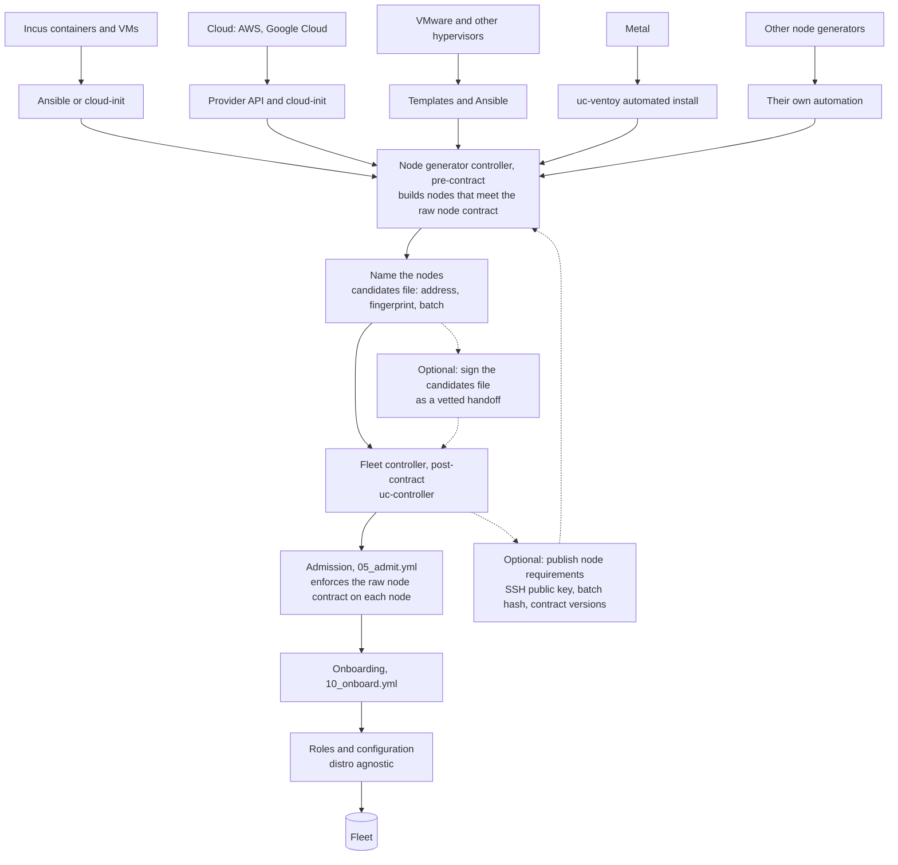

# Raw Node Flow

Two controllers share the work, with the raw node contract between them. The node generator controller builds nodes that meet the contract. The fleet controller admits them, onboards them, then configures them with distro agnostic methods.

## Reading the chart

### Build the nodes

Node sources run across the top, each with the method used to create nodes from it. The node generator controller, on the pre-contract side, drives those methods. Its sole job is to create nodes and prepare them to meet the contract. Each source gets its own shim, written in whatever that source requires: Ansible for Incus, a provider API for cloud, an automated installer such as uc-ventoy for metal. A new source means a new shim, and nothing on the orchestration side changes.

### Name the nodes

Each built node is named in a candidates file with its address, host key fingerprint and batch. A shim that can see its nodes writes the entries itself. For metal installs, the operator reads the address and fingerprint at the console. A subnet scan remains as a last resort, trusted on first use.

### Admission

The contract is enforced in one place only: admission. Naming a node only nominates it; admission checks each one against the contract before the orchestration controller takes it on.

### The orchestration controller

It onboards admitted nodes, then assigns roles and configuration to normalized nodes, using the same methods whatever the source.

### Optional at this scale

Two steps are not needed while one operator runs both controllers. Signing the candidates file turns it into a vetted handoff, which matters once another system writes it. Publishing node requirements automates passing the orchestration controller's public key, batch hash and accepted contract versions to the pre-contract side, which is done by hand for now. The handoff design note describes both for when they are needed.
