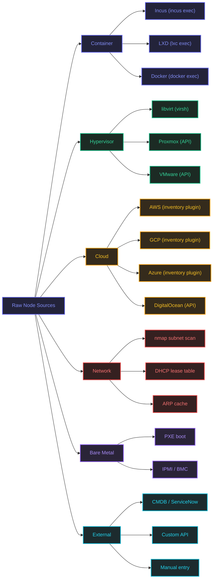

# Raw Node Source Taxonomy

The places a raw node can come from before it is onboarded, grouped by source type, with the access method for each where one applies.

## Sources by type

| Type | Source | Access method |
| --- | --- | --- |
| Container | Incus | `incus exec` |
| Container | LXD | `lxc exec` |
| Container | Docker | `docker exec` |
| Hypervisor | libvirt | `virsh` |
| Hypervisor | Proxmox | API |
| Hypervisor | VMware | API |
| Cloud | AWS | Inventory plugin |
| Cloud | GCP | Inventory plugin |
| Cloud | Azure | Inventory plugin |
| Cloud | DigitalOcean | API |
| Network | nmap subnet scan | |
| Network | DHCP lease table | |
| Network | ARP cache | |
| Bare Metal | PXE boot | |
| Bare Metal | IPMI / BMC | |
| External | CMDB / ServiceNow | |
| External | Custom API | |
| External | Manual entry | |
